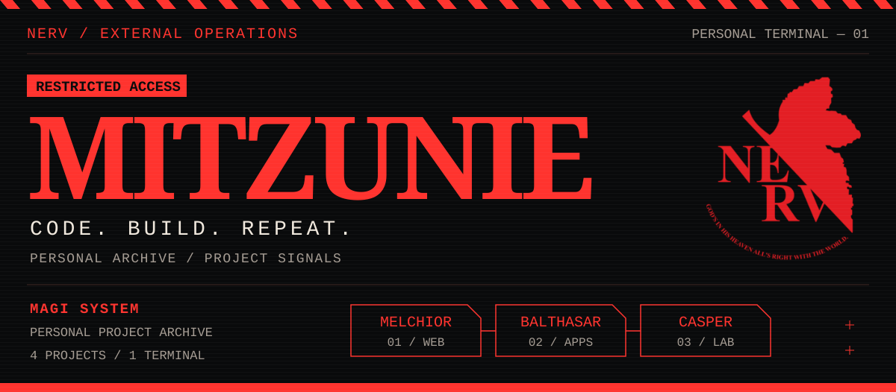
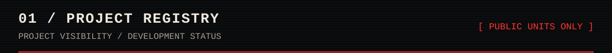
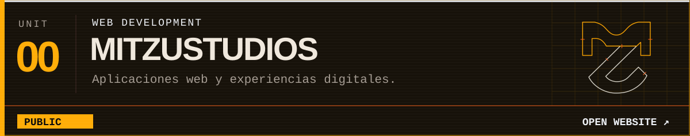
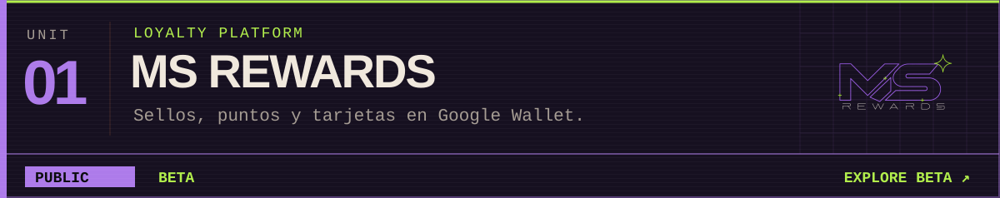
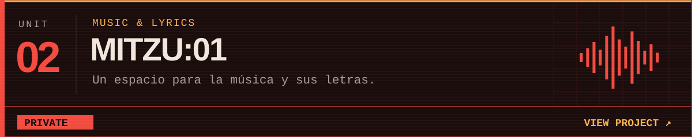
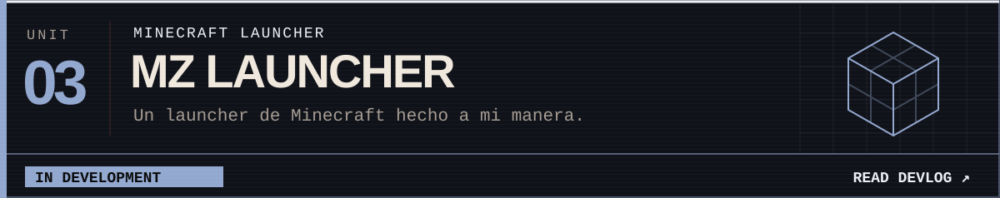
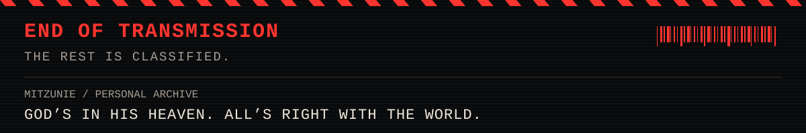

<!-- Assets locales: sube también la carpeta assets junto a este README. -->

  

  <a href="https://mitzustudios.online/">PORTFOLIO</a> &nbsp; / &nbsp;
  <a href="https://msrewards.xyz/">MS REWARDS · BETA</a> &nbsp; / &nbsp;
  <code>MITZU:01 · PRIVATE</code> &nbsp; / &nbsp;
  <a href="https://mitzustudios.online/blog/mz-launcher-por-que-me-hice-mi-propio-launcher-de-minecraft">MZ LAUNCHER · DEVLOG</a>

<code>[ ACCESS TEXT ARCHIVE ]</code>

| Unidad | Proyecto | Descripción | Estado | Visibilidad |
| :--- | :--- | :--- | :--- | :--- |
| 00 | [MitzuStudios](https://mitzustudios.online/) | Desarrollo web y experiencias digitales. | — | Público |
| 01 | [MS Rewards](https://msrewards.xyz/) | Fidelización para comercios con Google Wallet. | Beta | Público |
| 02 | MITZU:01 | Música y letras. | — | Privado |
| 03 | [MZ Launcher — Devlog](https://mitzustudios.online/blog/mz-launcher-por-que-me-hice-mi-propio-launcher-de-minecraft) | Launcher de Minecraft. | En desarrollo | — |

Los indicadores representan el estado declarado de los proyectos; no son un monitor en tiempo real.

